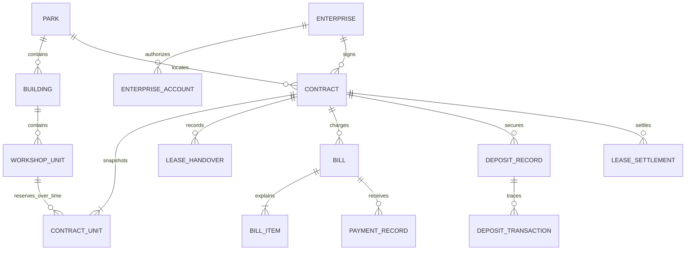

# 数据、API与事务设计

状态：依据已确认 Q1—Q27 整理的实现设计草案，供整体方案审阅。以下表名、字段名和 API 路径均为拟定名称，尚无实际 schema、migration 或已实现端点。旧38张备选表不直接视为最终表清单。

## 数据归属

| 业务包 | 数据职责与拟用实体 |
| --- | --- |
| system/security | `sys_user`、`sys_role`、权限、部门、园区角色授权、审批实例/历史、公告、待办、操作日志 |
| asset | `park`、`building`、`workshop_unit`，单元当前使用、合同区间与意向暂占的区分 |
| enterprise | `enterprise`、企业联系人、账号归属与企业内权限 |
| investment | `customer_lead`、`follow_record`、`site_visit`、`intention_order`，客户分配、公海与事件时间 |
| lease | `contract`、`contract_unit`、`lease_handover`、终止依据；续租关联原合同 |
| finance | `bill`、`bill_item`、`payment_record`、`deposit_record`、`deposit_transaction`、`lease_settlement`、账单调整、退款与押金转结依据 |
| property | `repair_order`及处理历史，单元与企业归属 |
| shared file service | `attachment`及业务绑定，由文件服务统一鉴权，业务包不拼接物理路径 |
| reporting | 查询聚合，不维护第二套合同或资金事实 |

已有设计实体复用名称不表示表结构原样复用。园区角色授权、企业成员权限、退款、账单调整、转结、工单历史和历史状态事件须核对实体覆盖，正式迁移时才冻结最终表名与总表数。不新增本期不做的在线支付、政策申报、能耗分摊表来凑完整度。

## 概念关系

这是概念ER，不代表SQL外键已经建立。员工/园区/角色形成三方授权关系；不能由一个全局角色和一组园区简单组合扩大权限。企业用户从服务端身份解析 `enterprise_id`，不信任前端提交的企业归属。合同必须同园区、同企业、相同租期，`contract_unit`保留价格和面积快照。

### 字段和时间建议

实现默认建议：主键使用BIGINT，JSON中的ID按字符串序列化；业务日期DATE，以Asia/Shanghai解释；审计时间明确以UTC保存、输出带时区时间，到账业务日期与录入审计时间分开。金额DECIMAL/BigDecimal，单价和中间算式保留足够精度，最终明细HALF_UP到分。

合同日期、计租日、交接日、终止生效日、费用截止日不得共用一个字段。合同原始 `start_date/end_date` 不因提前终止覆盖，另存批准后的合同预订截止依据；区间预订冲突按批准后的占用区间检查，费用计算使用批准费用截止日。实际交付还必须校验实际占用和OUT，终止已批准但未交还仍不得交付下一户，不能仅依据截断后的合同区间判为可交付。

Q27已确认：第一版正常情况下费用截止日与批准终止日一致；若协议另有安排，负责人在终止审批中分别确认费用截止日与占用截止依据，不允许财务直接改变。实际未交还产生的额外费用人工另行依据合同审批，不自动延长正常租金。

自然月折算沿用Q16。技术边界建议：2月29日起算的周年在非闰年取2月最后一天；整段免租覆盖整个合同则不产生租金应收，但按条款计算物业费；舍入按已确认的明细粒度统一，页面与后台使用同一计算结果。该类边界随整体方案审阅，实施时建立算例。

## 资金事实与更正

- 账单本金、调整、收款、押金抵扣、应退款分别追踪，汇总不能重复扣减。
- `payment_record`保留原收款，全额红冲追加反向记录。现金统计按实际到账与实际退款事实计算，不能把纯记账红冲当现金流出。
- 账单调整关联原 `bill/bill_item`；正差额形成待收，负差额先减少未收部分，超过部分形成有来源的应退金额。已发布历史明细不覆盖。
- Q26已确认：原收款已用于押金抵扣、退款或转结时，拒绝孤立红冲并提示依赖；先按原业务完成有审批的关联更正，再申请全额红冲并异人复核。真实已退资金不能用反向记账假装收回。该限制由Q26补充确认。审批本身不创造或消灭资金。
- 押金账户区分余额与可用额度。待退/待转冻结额度不得再抵扣，驳回/撤销释放额度；实际退款或转结执行时才改变账面余额。
- 押金抵欠同时记押金流水和目标账单核销；它是内部资金使用，不新增现金实收。转结同企业、同园区续租合同，成对记旧出新入，不通过复制一笔收款增加现金。
- 退款申请关联押金或预收租金应退来源，实际执行凭证与幂等号唯一；未签合同取消但已有实际收款时复用退款流程，已签合同则按终止结算流程处理。每次申请金额不超过该来源的可退额度，申请执行不可重复；未退余额保留，后续退款须另有批准依据。

以上为已确认业务的实现设计，最终资金字段及约束在migration审阅时明确，不额外限制企业分次退款。

## API约定与核心端点草案

统一 `/api`，API资金为十进制字符串。分页建议 `page/size`，返回 `items/total`；错误提供稳定业务 `code`、`message`与请求关联标识。HTTP 400参数、401未登录、403无权、404不可见资源、409状态或并发冲突；前端不从错误文本猜分支。涉及Cookie的写操作含登录/退出必须遵守CSRF配置，具体Security版本API在集成时核验。

| 用途 | 方法及拟定路径 | 关键约束 |
| --- | --- | --- |
| 认证 | POST `/api/auth/login`、`/logout`；GET `/api/auth/me`、`/csrf` | Session、CSRF、停用和授权变更处理 |
| 门户 | GET `/api/portal/parks`、`/units`；POST `/api/portal/leads`、`/visits` | 公开字段，限次防重复提交，不返回内部客户负责人 |
| 资产 | `/api/parks`、`/buildings`、`/units`；GET `/api/units/{id}/availability` | 园区授权、空间唯一、时间可用性 |
| 企业 | `/api/enterprises`；`/api/enterprise/members` | 运营核验、本企业身份及成员权限 |
| 招商 | `/api/investment/leads`、`/{id}/claim`、`/{id}/transfer`、`/{id}/follow-records` | 本人/部门/园区范围、领取幂等 |
| 意向 | `/api/intentions`；POST `/{id}/submit`、`/approve`、`/reject`、`/withdraw` | 报价节点、暂占所有者、到期时间 |
| 合同 | `/api/contracts`；POST `/{id}/submit`、`/approve`、`/reject`、`/sign`、`/activate`、`/cancel`、`/renewals` | 同一草稿ID、审批轮次、异人审核、区间冲突 |
| 交接及终止 | POST `/api/contracts/{id}/handovers`、`/termination-requests` | IN/OUT、批准终止区间、实际腾空 |
| 账单 | GET `/api/bills`、`/{id}`；POST `/api/finance/jobs/generate`、`/bill-adjustments` | 企业归属、幂等补漏、批准调整 |
| 收款更正 | POST `/api/bills/{id}/receipts`、`/api/receipts/{id}/reversal-requests` | 正额不超收、原款依赖、异人复核 |
| 押金结算 | `/api/deposits`、`/api/settlements`、`/api/deposit-deductions`、`/api/deposit-transfers` | 指定合同、目标账单、余额与冻结额度 |
| 退款 | `/api/refund-requests`；POST `/{id}/approve`、`/reject`、`/withdraw`、`/execute` | 来源、异人复核、实际凭证、执行幂等 |
| 工单 | `/api/repairs`；POST `/{id}/assign`、`/complete`、`/confirm`、`/rework-requests` | 授权单元、处理人、超时关闭非验收 |
| 汇总待办 | GET `/api/reports/*`、`/api/tasks`、`/api/notices` | 范围与明细一致，统计口径可查 |
| 文件导出 | POST `/api/attachments`；GET `/{id}/download`；`/api/exports/*` | 业务归属、白名单与容量上限 |

表中以资源根表示的一组API仍需拆成具体方法；这是边界清单，不宣称已生成完整OpenAPI。服务器从身份与已授权资源解析范围，不因路由隐藏按钮而跳过校验。

## 事务与锁边界

| 业务入口 | 同一事务内必须完成 |
| --- | --- |
| 意向通过/合同终审 | 锁审批与单元、校验授权与日期区间、记录批准、取得或接管暂占/预订 |
| 多单元合同 | 单元ID排序去重后加行锁；任何一单元冲突则整体回滚 |
| 收款/红冲 | 锁账单与原收款、检查余额和依赖、追加流水、更新核销摘要及审计 |
| 押金抵扣/转结/退款执行 | 按全局一致顺序锁目标账单及押金账户/申请，额度校验、关联流水、状态与审计同时提交 |
| OUT/续租承接 | 锁相关合同与单元，确认交还或连续使用依据后变更实际占用来源 |
| 预约确认 | 校验槽位、单元与人员冲突，确认记录与槽位占用同时提交 |
| 出账补跑 | 单合同独立事务，账单业务键防重；一合同失败不吞错也不阻塞全部 |

统一锁顺序必须覆盖不同命令，不能每个Service自定。状态更新附旧状态/版本校验，幂等标识加唯一约束；资源区间不重叠不能仅靠普通唯一键表达。跨包协作由用例入口Service持有事务，不以内部HTTP调用拆散事务。

文件不参与MySQL事务：先临时上传，再经业务授权绑定，过期未绑定文件可清理。合同附件保留版本，不覆盖原文件；静态站点目录与私有附件目录分开。

## 与前期设计的差异

- 账号权限需补园区-用户-角色及企业成员权限，不能只依赖 `sys_user.park_id` 或全局角色。
- Session取代JWT建议；不因旧文档提到Redis而引入必需依赖。
- 退款、调整、转结、冻结额度和处理历史须有持久化依据；原资金字段不能一项多用。
- 本期不建完整在线支付、能耗、政策流程，不沿用旧表数作为指标。
- 正式建库前核对旧 `schema.sql/schema-completion.sql`，以Flyway版本化迁移交付；本轮未修改或执行旧SQL。
